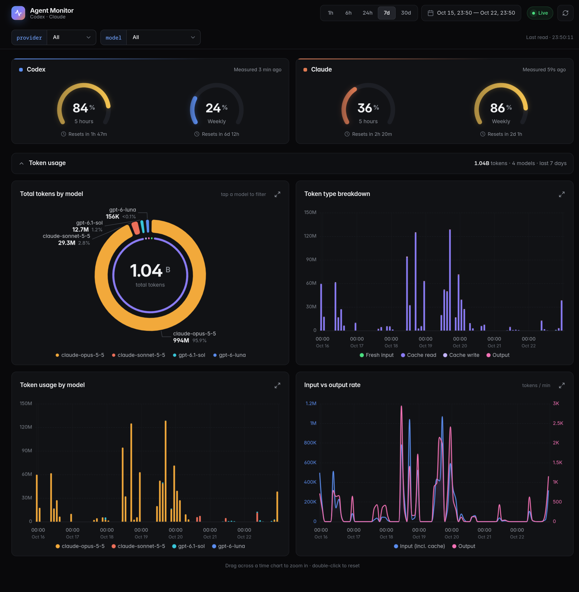
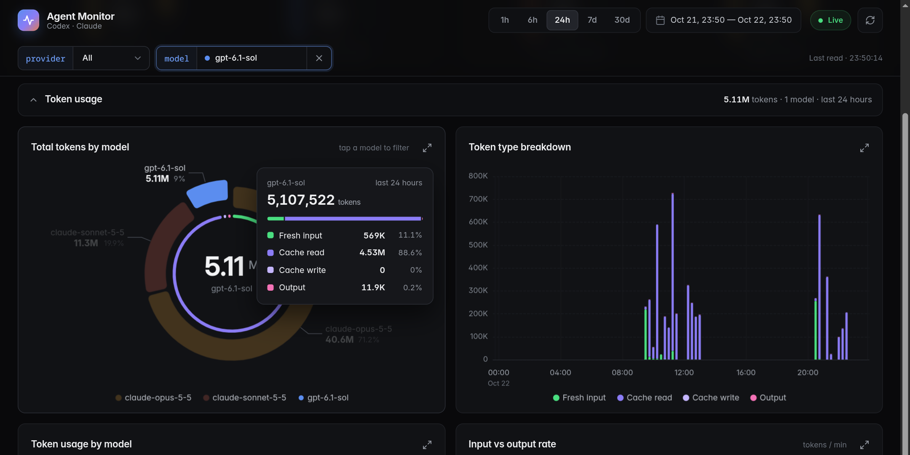
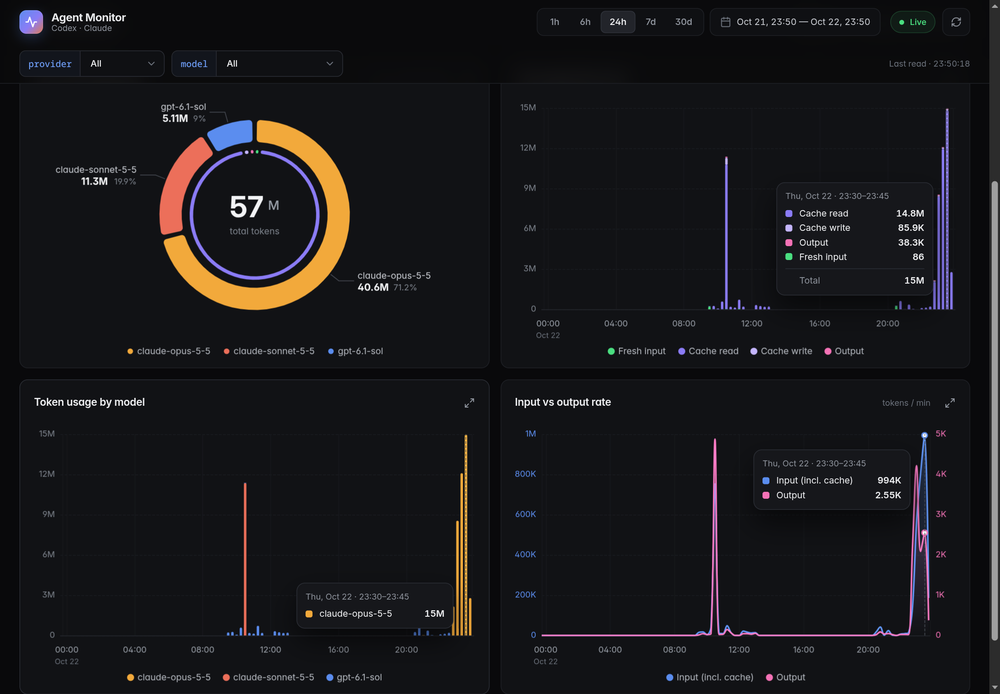
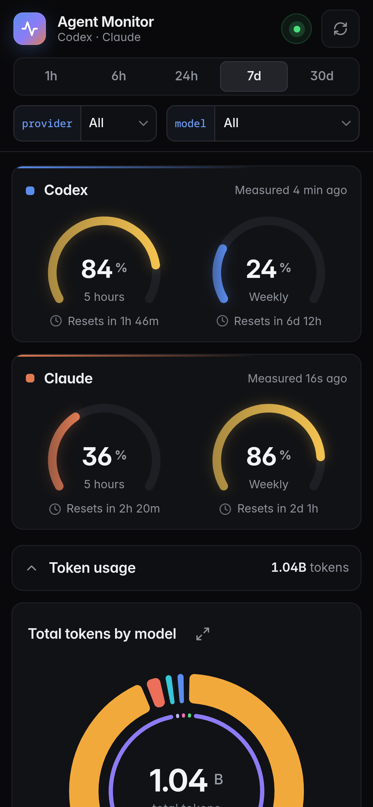
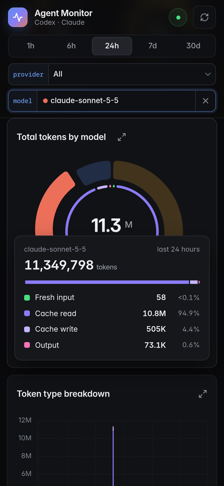

<p align="center">
  
</p>

<h1 align="center">Agent Monitor</h1>

<p align="center">
  <strong>A live dashboard for your Codex and Claude subscriptions.</strong><br>
  Quotas, token usage and agent sessions, in your terminal and on your phone.
</p>

<p align="center">
  <a href="#quick-start">Quick start</a> &middot;
  <a href="#phone-access-with-tailscale">Phone access</a> &middot;
  <a href="#everyday-commands">Commands</a> &middot;
  <a href="#troubleshooting">Troubleshooting</a> &middot;
  <a href="./docs/site/docs/guides/agent-monitor.md">Full guide</a>
</p>

<p align="center">
  
  
  
  
</p>

---



Agent Monitor is a fork of [OpenUsage](https://github.com/janekbaraniewski/openusage)
focused on two subscriptions: **Codex** (ChatGPT plan) and **Claude Code**
(Claude plan). It answers the questions you ask while an agent is working:
*how much of my 5-hour window is left, when does it reset, which model is
eating the tokens, and how much of that is cache?* A background collector
reads the official clients' local logs and quota endpoints, and you watch it
from a terminal view or a web dashboard you can open on your phone from
anywhere, privately, through Tailscale.

<table>
  <tr>
    <td width="50%"></td>
    <td width="50%"></td>
  </tr>
  <tr>
    <td align="center"><em>Filter by model and see fresh input, cache and output at a glance.</em></td>
    <td align="center"><em>One cursor, three charts: every time chart marks the same interval.</em></td>
  </tr>
</table>

<p align="center">
  
  &nbsp;&nbsp;
  
  <br>
  <em>Built for the phone first: sticky filters, tap-to-filter and a tap-for-details breakdown.</em>
</p>

## Features

- **Quota gauges** for the Codex and Claude 5-hour and weekly windows, with
  reset countdowns. They turn amber at 80% and red at 95%.
- **Token usage dashboard**: total by model, token type breakdown over time,
  usage by model over time, and input vs output rate.
- **Cache inside the totals**: the inner ring and the breakdown card split
  every total into fresh input, cache read, cache write and output.
- **Responsive filters**: tap a model or a quota card to filter, tap again or
  press `Esc` to clear. The filter bar stays visible while you scroll, and
  the state lives in the URL, so you can bookmark a view.
- **Synced cursor and drag-to-zoom** across all time charts, and a full-screen
  view for any chart.
- **Terminal view** with live per-session state (`Working`, `Needs input`,
  `Turn done`), tokens, model and last tool.
- **Private remote access**: a rootless Tailscale node with automatic Serve
  setup. No open ports, no passwords to manage, no public exposure.
- **Read-only and local**: the web server listens on loopback, accepts only
  `GET`, sends strict browser isolation headers and never exposes credentials,
  prompts or full paths.

## How it works

```
 Codex CLI logs ─┐                        ┌─ terminal view  (agent-monitor)
 Claude Code logs ┼─► collector (systemd) ─┤
 quota endpoints ─┘   SQLite + socket      └─ web dashboard  (127.0.0.1:8787)
                                                   │
                                     Tailscale Serve (private tailnet)
                                                   │
                                               your phone
```

Everything runs as **user** services: no root, no system packages. All
monitor data lives in `.runtime/` inside the project.

## Requirements

- Linux with systemd user services.
- Go 1.26+ with CGO and a C compiler (`gcc`), for the SQLite store.
- Python 3, for the Tailscale connector.
- [Codex CLI](https://github.com/openai/codex) and/or
  [Claude Code](https://docs.anthropic.com/en/docs/claude-code), signed in
  with your subscription.
- A free [Tailscale](https://tailscale.com) account, for phone access.

## Quick start

```bash
git clone https://github.com/nxmxl3zz/agent-monitor.git
cd agent-monitor
make build

# Optional: put the launcher on your PATH
mkdir -p ~/.local/bin && ln -s "$PWD/scripts/agent-monitor" ~/.local/bin/agent-monitor

agent-monitor service install       # background collector
agent-monitor web-service install   # web dashboard on 127.0.0.1:8787
agent-monitor                       # terminal view
```

Open <http://127.0.0.1:8787> on your computer. The first quota reading
arrives within about a minute.

## Phone access with Tailscale

Tailscale puts your computer and your phone on a private network (a
*tailnet*). Only your signed-in devices can reach the dashboard, over
WireGuard encryption, from any Wi-Fi or mobile network.

### 1. Install the dedicated node on your computer

```bash
agent-monitor remote install
```

This downloads the official static Tailscale build from `pkgs.tailscale.com`,
verifies its SHA-256 checksum, installs it in `~/.local/lib/agent-monitor/` and
starts two user services:

- `agent-monitor-tailscale.service`: a rootless Tailscale node named
  `agent-monitor`.
- `agent-monitor-remote.service`: a connector that keeps the web service's
  allowed hosts and Tailscale Serve in sync with that node.

It does not touch an existing system Tailscale install.

### 2. Sign the node in

```bash
agent-monitor remote login
```

Open the printed link and approve the device with your Tailscale account.

### 3. Get the address

```bash
agent-monitor remote status
```

Once `state` is `ready`, `url` shows the dashboard address, for example
`http://agent-monitor.tail1234.ts.net`.

### 4. Open it on your phone

1. Install the Tailscale app ([Android](https://play.google.com/store/apps/details?id=com.tailscale.ipn) / [iOS](https://apps.apple.com/app/tailscale/id1470499037)) and sign in with **the same account**.
2. Turn the VPN toggle on.
3. Open **`http://agent-monitor`** in the browser. If the short name does not
   resolve, check that *Use Tailscale DNS* is enabled in the app, or use the
   full URL from step 3.
4. Optional: *Add to Home screen* to get an app-like icon.

### 5. Optional: HTTPS and a nicer name

- **HTTPS**: if `remote status` shows `enable_https_url`, open it once to let
  Tailscale issue a certificate. The connector switches to `https://` on its
  own.
- **Readable tailnet name**: the `tail1234.ts.net` suffix is random. In the
  Tailscale admin console, **DNS → Rename tailnet** lets you pick one of the
  readable names it suggests. The connector follows the new name
  automatically.

### Already running Tailscale?

If your computer is already on a tailnet, you can skip the dedicated node and
publish through the existing install instead:

```bash
agent-monitor web-service install your-pc.your-tailnet.ts.net
sudo tailscale serve --bg --https=443 http://127.0.0.1:8787
```

> [!IMPORTANT]
> Always use **Serve**, never **Funnel**. Funnel would publish the dashboard to
> the whole internet, and the server has no login of its own: Tailscale is the
> authentication.

## Everyday commands

| Command | What it does |
|---|---|
| `agent-monitor` | Open the terminal view. |
| `agent-monitor --json` | Print quotas and sessions as JSON. |
| `agent-monitor service status\|restart\|stop\|uninstall` | Manage the collector. |
| `agent-monitor web-service status\|restart\|stop\|uninstall` | Manage the web dashboard. |
| `agent-monitor remote status\|restart\|stop\|start` | Manage phone access. |
| `agent-monitor remote uninstall` | Remove the Tailscale node services and binaries. |
| `agent-monitor tailscale <args>` | Run any Tailscale CLI command against the dedicated node. |

After `make build`, restart the services to load the new binary:

```bash
systemctl --user restart agent-monitor.service agent-monitor-web.service
```

### Terminal view keys

`Tab` provider · `↑`/`↓` session · `/` filter · `Esc` clear · `h` period ·
`t` theme · `r` refresh quotas · `q` quit (the collector keeps running).

## Configuration

The launcher copies [`configs/agent-monitor.json`](./configs/agent-monitor.json)
to `.runtime/config/settings.json` on first run; edit that copy to change the
theme, refresh interval, retention or dashboard sections. The profile tracks
only Codex and Claude Code and hides API-equivalent cost estimates, since
both are flat-rate subscriptions.

| Path | Contents |
|---|---|
| `.runtime/config/` | Settings and themes. |
| `.runtime/state/openusage/` | Usage database, collector socket and state. |
| `.runtime/remote/status.json` | Tailscale connector status. |
| `~/.local/state/agent-monitor-tailscale/` | Tailscale node identity (mode 0700). |

## Security and privacy

- The web server binds to loopback only and rejects unknown `Host` headers,
  cross-site requests and every method except `GET`/`HEAD`.
- Responses carry a strict Content Security Policy (`default-src 'self'`, no
  inline scripts or styles), `frame-ancestors 'none'` and `no-store` caching.
  All assets, including the font and the chart library, are embedded in the
  binary: the page loads nothing from third parties.
- The dashboard API publishes quotas and aggregated token counts only. The
  snapshot API adds session metadata with project basenames, never full
  paths. Neither includes credentials, prompts, responses or tool arguments.
- Credentials stay with the official clients. The monitor never sends prompts
  and never stores API keys.

## Troubleshooting

| Symptom | Fix |
|---|---|
| Claude card shows `Rate limited · retrying` | Anthropic throttles the quota endpoint. Readings resume on their own; avoid restarting the collector repeatedly, which drops the cached reading. |
| A card shows `Sign in required` | Sign in again with the official client (`codex login` or `claude`). |
| The page says `Offline` | Check `agent-monitor service status`; the page keeps the last reading until the collector is back. |
| The phone cannot open the dashboard | The Tailscale app must be connected on the phone, and `agent-monitor remote status` must say `ready`. For the short name, enable *Use Tailscale DNS*. |
| `remote status` shows an `auth_url` | The node needs to be signed in again: run `agent-monitor remote login`. |

## Built on OpenUsage

This project is a fork of [OpenUsage](https://github.com/janekbaraniewski/openusage)
by Jan Baraniewski, a terminal dashboard for many AI coding tools. Everything
from OpenUsage still works through `./bin/openusage`; see the
[upstream README](https://github.com/janekbaraniewski/openusage#readme) and
[openusage.sh](https://openusage.sh/) for the full provider list and docs.

What this fork adds:

- The `monitor` terminal view and the `web` dashboard (`internal/tui/agent_monitor.go`, `internal/monitorweb/`).
- Session activity and usage analytics in the collector (`internal/telemetry/session_activity.go`, `internal/telemetry/monitor_analytics.go`).
- An `OPENUSAGE_CONFIG_DIR` override and a dedicated Codex + Claude profile.
- Claude OAuth renewal through the official CLI, and rate-limit reporting for the quota endpoint.
- Launcher and user-service scripts in `scripts/`, including the rootless Tailscale connector.

## License

[MIT](./LICENSE), like upstream. The embedded [Apache ECharts](https://echarts.apache.org)
build is Apache-2.0 and the embedded [Inter](https://rsms.me/inter/) font is
SIL OFL 1.1; their license files ship next to them in
`internal/monitorweb/assets/`.
